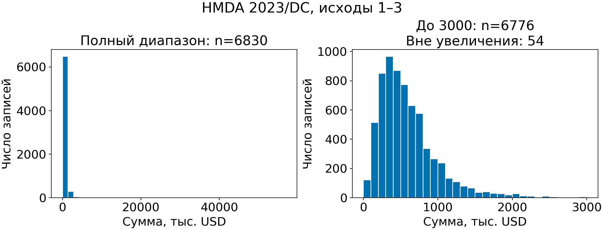
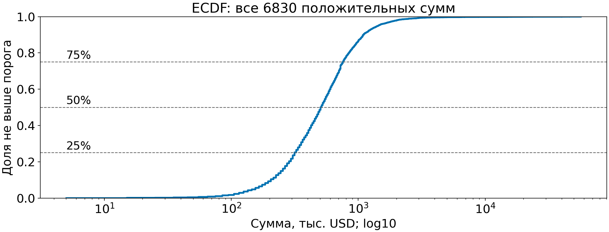
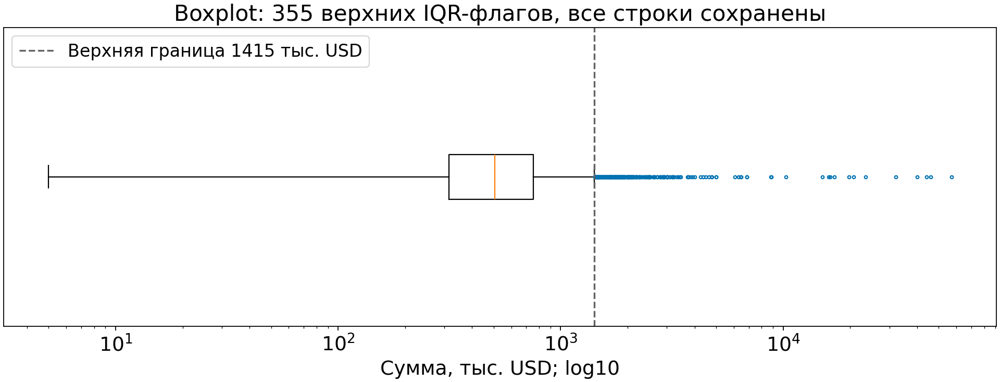
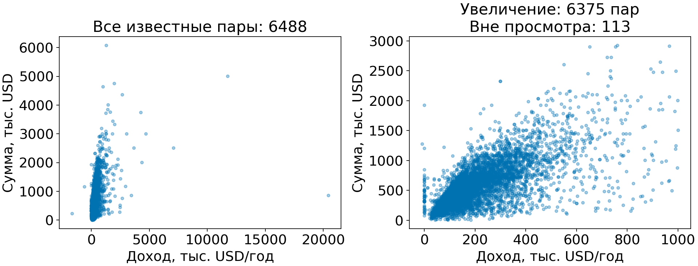

# Лекция 5 Исследовательский анализ данных

2026-11-21. 90 минут.

Сначала изучите эту тему на лекции. На практике в этот день обсуждается предыдущая тема.

## 1 Что считать типичной суммой

В нашей таблице есть суммы кредита. Как описать их одним числом? Если сложить все суммы и разделить на число записей, получится около 670 тысяч долларов. Если расположить суммы по порядку и найти середину, получится 505 тысяч. Оба расчёта верны: они отвечают на разные вопросы.

Сегодня научимся выбирать показатель под вопрос. Сначала разберём среднее и медиану на четырёх настоящих строках, затем посмотрим на весь набор. После этого сравним группы и связь суммы с доходом. Так устроен исследовательский анализ, EDA: мы рассматриваем данные, замечаем особенности и намечаем, что проверять дальше. Работаем с теми же 6830 ипотечными записями HMDA за 2023 год. Одна строка здесь — опубликованная запись, поэтому число строк не называем числом уникальных клиентов.

## 2 Что означает значение столбца

Перед вычислением выясним, что означает столбец. loan_amount хранит сумму в долларах: разность двух значений имеет понятный смысл. action_taken содержит числа 1, 2 и 3, но это коды исходов. Их можно заменить словами: выдача, одобрение без принятия, отказ. Среднее кодов не описывает ни сумму, ни долю одобрений.

Тип хранения и смысл переменной различаются. int64 сообщает, как Python хранит значение, но не выбирает за нас способ анализа. Для категорий считаем частоты и доли. Для количественной суммы ищем середину, разброс и распределение. Найдите в первых строках loan_amount, income и action_taken. Прежде чем вызвать метод, скажите словами, какой результат хотите получить. activity_year в нашем наборе везде равен 2023: по этому столбцу нельзя изучать изменения по годам.

|Поле|Смысл|Подходящий обзор|
|---|---|---|
|loan_amount|Сумма, USD|Центр/разброс|
|income|Доход, тыс. USD/год|Квантили + пропуски|
|action_taken|Категория исхода|Частоты/доли|
|lei|Идентификатор|Число групп|

## 3 Проверяем единицы и известные значения

Откроем первые строки и размеры таблицы. loan_amount хранится в долларах, а income — в тысячах долларов за год. Создадим loan_kusd делением суммы на тысячу. Исходное поле оставим рядом: по нему удобно проверить перевод единиц.

Всего у нас 6830 записей. Сумма известна у каждой, доход — у 6488; ещё 342 значения дохода пропущены. Метод count считает известные значения, а len — все строки. Поэтому средний доход и средняя сумма могут использовать разное число наблюдений. Также увидим 50 неположительных известных доходов. Сейчас сохраняем их и явно описываем, какие значения входят в расчёт. Если позже захотим делить на доход или использовать логарифм, сначала отдельно определим допустимые значения. Такая проверка нужна до формулы, иначе программа может посчитать показатель с другим смыслом.

## 4 Среднее: сумма, делённая на количество

Возьмём первые четыре суммы и переведём их в тысячи долларов: 275, 585, 275 и 295. Их сумма равна 1430. Делим на четыре записи и получаем среднее 357,5. Можно представить, что общий объём распределён поровну между этими четырьмя строками.

Метод mean выполняет этот расчёт. Если умножить среднее на число известных значений, восстановим сумму. Поэтому среднее полезно, когда нас интересует общий объём вместе с количеством записей. Каждая сумма влияет на результат: очень большая запись способна заметно его сдвинуть. Сейчас сравним ручной ответ с pandas. Затем зададим другой вопрос: какая сумма находится в середине списка? Для него понадобится медиана. Первые четыре строки используются только для разбора арифметики, вывод обо всём наборе по ним не делаем.

## 5 Медиана: середина упорядоченного списка

Упорядочим те же четыре суммы: 275, 275, 295, 585. При чётном числе значений середина находится между вторым и третьим. Усредняем 275 и 295: медиана равна 285 тысячам долларов. При нечётном количестве взяли бы одно центральное значение.

Медиана отвечает на вопрос о центральном положении в отсортированном списке. Большая последняя сумма влияет на среднее, но пока порядок не меняется, не меняет два центральных значения. На полном наборе медиана составляет 505 тысяч долларов, среднее — примерно 670 тысяч. Это повод посмотреть распределение и крупные значения. Само различие ещё не объясняет, почему появились большие суммы. Выполним median и сравним результаты на маленьком списке и всей таблице; единицы подпишем у обоих ответов.

## 6 Мода и частоты

В четырёх суммах значение 275 встречается дважды, остальные — один раз. Поэтому мода здесь 275. mode возвращает Series: самых частых значений может оказаться несколько. Чтобы увидеть всю картину, вызовем value_counts — получим каждое значение и число его появлений.

Для action_taken особенно полезны частоты: 5956 выдач, 183 одобрения без принятия и 691 отказ. Их сумма должна дать 6830. Мода этого столбца сообщит только самый частый исход и скроет остальные количества. Для суммы кредита частоты тоже можно посчитать, но нужно помнить об особенностях опубликованных значений: повторяющаяся сумма не обязательно означает повтор одной заявки. Сначала прочитаем результат метода, затем выберем форму ответа под вопрос: одно наиболее частое значение или таблица всех частот.

## 7 Квантили: значения на заданных местах

Медиана делит упорядоченный список на две части. Квантили позволяют указать другие положения. Q1, первый квартиль, соответствует уровню 25%, Q3 — уровню 75%. На нашей таблице pandas получает 315 и 755 тысяч долларов. Между ними находится центральная часть распределения.

Если заданное положение попадает между соседними наблюдениями, нужно правило получения значения. В демонстрации используем linear: pandas вычисляет промежуточное значение по расстоянию между позициями. Поэтому при сравнении с другой программой проверяем одинаковое определение. Вызов quantile получает список уровней от нуля до единицы. Найдите в выводе 0.25, 0.5 и 0.75 и прочитайте каждую сумму вместе с единицей. При совпадающих значениях ровно четверть строк не обязана лежать строго ниже Q1: одинаковые суммы могут занимать несколько соседних мест.

## 8 Как описать разброс

Две группы могут иметь одинаковую медиану, но разные расстояния между значениями. Для этого описывают разброс. Самый прямой показатель — диапазон: из максимума вычитаем минимум. На него сильно влияют крайние наблюдения.

Другой показатель — межквартильный размах, IQR. Это расстояние от Q1 до Q3. Для нашей суммы получаем 755000 минус 315000, то есть 440000 долларов. Он характеризует ширину центральной части списка и меньше зависит от отдельных крайних значений. Сравним оба показателя в коде. У них те же единицы, что у исходной суммы. Если переводим всю сумму из долларов в тысячи долларов, диапазон и IQR тоже уменьшаются в тысячу раз. Выбор показателя зависит от того, интересуют нас крайние значения или основная часть наблюдений.

## 9 Стандартное отклонение

Вернёмся к четырём суммам и среднему 357,5. Из каждого значения вычтем среднее. Получатся положительные и отрицательные отклонения; их сумма почти нулевая, поэтому она не показывает разброс. Возведём отклонения в квадрат и сложим.

В примере делим сумму квадратов на n−1. Такой вариант дисперсии в pandas задаётся ddof=1. Из дисперсии извлекаем квадратный корень и получаем стандартное отклонение, SD. Дисперсия измеряется в квадратных единицах, SD — снова в тысячах долларов. В NumPy и pandas значения по умолчанию могут различаться, поэтому одинаковый ddof указываем явно. SD описывает разброс наблюдаемых сумм вокруг среднего. Позже мы отдельно изучим изменчивость оценки среднего при повторных выборках; сейчас считаем характеристику самих значений.

## 10 describe: сводка с понятными строками

Мы уже разобрали показатели по отдельности. Теперь describe соберёт их в одну таблицу: количество известных значений, среднее, стандартное отклонение, минимум, квартили и максимум. Выберем только loan_amount и income, затем транспонируем результат через .T, чтобы каждая исходная переменная занимала строку.

Прочитаем строку loan_amount целиком: что означает count, в каких единицах mean и std, где стоит медиана? Затем посмотрим income. Здесь count меньше числа строк, потому что доход иногда неизвестен. Если вызвать describe без выбора столбцов, технические числовые коды тоже могут попасть в результат. Поэтому выбираем поля по смыслу. Сводка помогает найти вопросы для просмотра распределения, но нескольких чисел недостаточно, чтобы увидеть несколько пиков или отдельную крупную запись.

## 11 Гистограмма: сколько значений в интервале

Гистограмма разбивает числовую ось на интервалы и считает, сколько сумм попало в каждый. Это отличается от столбцов категорий: соседние интервалы связаны порядком числовой шкалы. Укажем bins и посмотрим рисунок полного диапазона.

Крупные суммы могут растянуть ось так, что основная часть окажется сжата слева. Поэтому рядом покажем увеличение до трёх миллионов долларов. Подпишем, сколько записей осталось в видимой части и сколько находится за её пределами. Сам исходный набор при этом не меняется. Если ширина интервалов другая, число и высота пиков тоже могут измениться. Начнём чтение с осей и единиц, затем найдём интервал с большим количеством записей. Не будем пока давать этому пику название группы клиентов: для такого объяснения потребовались бы дополнительные поля и проверка.

## 12 ECDF: доля не выше заданной суммы

Есть другой способ показать распределение без выбора ширины интервалов. Отсортируем суммы. Для первой точки накопленная доля равна 1/n, для второй — 2/n, для последней — единице. Получится эмпирическая функция распределения, ECDF.

Чтобы узнать долю сумм не выше выбранного порога, найдём его на горизонтальной оси и прочитаем высоту ступени. Повторяющиеся значения дают более крупный скачок. Проверьте один такой ответ обычным фильтром .le(...).mean(): логические True считаются как единицы, False — как нули. В примере суммы положительные, поэтому для обзора широкого диапазона допустима логарифмическая ось. На следующем занятии подробнее разберём, как она меняет расстояния на рисунке. Сейчас главное — связать высоту ECDF с конкретным числителем и общим числом известных сумм.

## 13 Асимметрия распределения

На гистограмме основная масса сумм находится ближе к началу оси, а отдельные большие значения продолжают распределение вправо. Такую форму называют правой асимметрией. В этом наборе среднее выше медианы, что согласуется с влиянием крупных сумм.

Метод skew возвращает числовую характеристику асимметрии. Его полезно читать вместе с рисунком: одно число не рассказывает, как именно устроен хвост и сколько крупных наблюдений в нём находится. Асимметрия — описание формы, а не объяснение её возникновения. Мы можем предположить различие объектов или состава заявок, но эти причины ещё предстоит проверить. В записке укажем, что видно: среднее, медиана, единицы и форма распределения на нашем сохранённом отборе. Формулировку причины отложим до появления соответствующих данных.

## 14 Boxplot и правило IQR

На boxplot коробка тянется от первого до третьего квартиля, линия внутри показывает медиану. При стандартном правиле 1,5 IQR «усы» заканчиваются на крайних наблюдениях внутри допустимого расстояния от квартилей. Отдельные точки за ними часто называют выбросами по этому правилу.

Для нашей суммы верхняя граница равна 755000 плюс 1,5 × 440000, то есть 1415000 долларов. Выше неё находятся 355 записей. Правило помогает найти значения для просмотра. Оно само не устанавливает ошибку ввода: крупная сумма может быть корректным наблюдением. Создадим логическую маску и покажем строки за границей, сохранив исходные данные. Затем сравним результат анализа при двух политиках: со всеми суммами и без этих верхних флагов. Такой расчёт покажет чувствительность выбранного показателя.

## 15 Что изменится при исключении флагов

Построим таблицу сравнения. В первой строке будут все 6830 сумм, во второй — суммы без 355 верхних IQR-флагов. Посчитаем количество, среднее и медиану по одинаковым формулам. Подпишем правило отбора, чтобы было понятно, откуда возникла разница.

Среднее заметно реагирует на удаление крупных значений; медиана тоже может измениться. Это показывает зависимость результата от состава данных. Мы не называем второй набор исправленным, пока не установили, что исключённые значения ошибочны или не относятся к нашему вопросу. Если вопрос касается всех опубликованных записей, основной ответ сохраняет их все. Дополнительное сравнение можно привести рядом. В отчёте укажите оба результата и причину выбора основного: читатель должен иметь возможность повторить тот же отбор.

|Политика|n|Mean / median USD|
|---|---|---|
|Все записи|6830|670199 / 505000|
|Без верхних IQR-флагов|6475|537942 / 485000|

## 16 Сравнение групп

Теперь разобьём данные по action_taken. Одна группа — выдачи, другая — одобрения без принятия, третья — отказы. Метод groupby уже знаком. В agg укажем несколько именованных результатов: n считает строки, loan_median — медиану суммы, income_known — известные значения дохода.

Рядом с медианой нужны размеры групп. Небольшая группа и большая могут показывать похожий центр, но содержать разный разброс и состав. Для дохода отдельно выведем количество пропусков. Прочитайте одну строку сводки словами: какой исход, сколько записей, какая медиана и в каких единицах? После этого можно описать различие групп в нашем наборе. Чтобы объяснить, чем оно вызвано, потребуются дополнительные сравнения; итоговое решение по заявке само по себе не определяет причину разницы сумм.

## 17 Таблица сочетаний и доли

Проверим, одинаково ли часто доход пропущен при разных исходах. crosstab строит таблицу частот сочетаний: по строкам action_taken, по столбцам логический признак income.isna(). False означает известный доход, True — пропуск.

Сначала посмотрим количества, затем normalize="index" поделит каждую строку на её сумму. Получим доли внутри каждого исхода. У отказов пропущено 65 из 691 дохода. Если же разделить те же 65 на все 342 пропуска, ответим на другой вопрос: какая доля записей с пропуском относится к отказам. Числитель одинаков, знаменатели различаются. Перед чтением процента назовите, какие строки составляют сто процентов. Этот приём пригодится и для условных вероятностей на следующем блоке курса.

## 18 Пропуски по группам

Из таблицы получились три разные доли пропусков дохода. Для выдач это 244 из 5956, для одобрений без принятия — 33 из 183, для отказов — 65 из 691. Посчитаем проценты и проверим, что количества пропусков суммируются в 342.

Если удалить все строки с неизвестным доходом, группы уменьшатся в разных пропорциях. Поэтому сравнение дохода по известным значениям описывает оставшиеся записи. В записке указываем количество известных доходов каждой группы и используем его как знаменатель соответствующего расчёта. По этим полям мы видим, где пропуски встречаются чаще, но не знаем причину отсутствия дохода. Для объяснения потребовались бы сведения о сборе и обработке данных. Сам факт различия полезен: он определяет, как осторожно читать последующие сравнения.

## 19 Среднее групп и среднее записей

Представьте две организации: у первой десять записей, у второй тысяча. Если усреднить их средние без весов, обе организации повлияют на ответ одинаково. Если вопрос о средней сумме одной записи, вклад организации должен зависеть от количества её известных сумм.

Посчитаем среднее по всем строкам, затем средние организаций. Взвешенный ответ восстанавливается так: каждое среднее умножаем на размер соответствующей группы, складываем произведения и делим на сумму размеров. Для loan_amount все значения известны, поэтому вес равен числу строк. Для income понадобилось бы число известных доходов. Проверим совпадение прямого и взвешенного расчётов. Простое среднее по организациям тоже может быть осмысленным, если вопрос именно об одинаково взвешенных организациях; это другой показатель, его нужно так и назвать.

## 20 Связь суммы с доходом

Рассмотрим сразу два количественных поля: доход и сумму. Для каждой записи с известными обоими значениями поставим точку на scatter: по горизонтали доход, по вертикали сумма. Таких пар 6488. Разные единицы подпишем явно.

Сначала посмотрим полный рисунок: есть ли общее направление, отдельные крупные значения, плотные участки? Затем при необходимости увеличим участок с подписью числа точек вне просмотра. Наблюдаемая связь может иметь сложную форму: быть примерно линейной, изогнутой или слабой. Один коэффициент не заменяет просмотр. Перед вычислением корреляции проверим количество пар и убедимся, что сравниваем значения одной записи. Нельзя отдельно удалить пропуски из двух столбцов, а затем сопоставить оставшиеся значения по новому порядку: пары окажутся нарушены.

## 21 Корреляция Pearson

Коэффициент Pearson описывает линейную совместную изменчивость двух количественных полей. Положительный знак означает, что большие значения одного обычно сочетаются с большими значениями другого; отрицательный — с меньшими. Чем ближе модуль к единице, тем теснее точки расположены около прямой. Значение около нуля говорит о слабой линейной связи, хотя другая форма связи может сохраняться.

Вызовем corr(method="pearson") для явно выбранных income и loan_amount. pandas использует известные пары. Укажем их количество рядом с коэффициентом; min_periods задаёт минимальное число пар, а не проверку статистической значимости. На нашем срезе коэффициент около 0,466. Крупные наблюдения могут сильно влиять на него, поэтому сопоставляем число с уже просмотренным scatter. Из корреляции не следует, что изменение дохода само вызовет рассчитанное изменение суммы.

## 22 Корреляция Spearman

Spearman сначала заменяет значения их рангами, то есть местами в отсортированном списке. Затем оценивает связь этих рангов. Совпадающим значениям назначаются усреднённые ранги. Такой коэффициент помогает описывать монотонную связь: значения в целом растут вместе, даже если зависимость на исходной шкале не похожа на прямую.

Вычислим его на тех же 6488 парах. Получим около 0,718, что отличается от Pearson. Различие связано с разными вопросами методов; выбирать самый большой коэффициент ради более убедительного вывода не нужно. Запишем названия обоих методов и свяжем их с формой рисунка. Ни ранжирование, ни другой коэффициент не устраняют смешение факторов и ограничения отбора. Это два описания связи в сохранённых данных, а объяснение механизма потребует отдельной проверки.

## 23 Наблюдение и возможное объяснение

Сформулируем наблюдение: медиана суммы у выдач отличается от медианы у отказов. Его можно проверить по сводной таблице. Возможное объяснение — группы различаются по составу заявок. Этого пока не проверяли, поэтому запишем отдельно как гипотезу.

Чтобы продолжить анализ, нужно указать следующий шаг: какие признаки состава доступны, какие ещё нужны и как сравнить более похожие записи. В журнале сохраняем вопрос, использованные поля, отбор, показатель, результат и возможные объяснения. Если просмотрели много разбиений, отражаем это: случайно заметное различие среди множества сравнений не становится заранее ожидавшимся результатом. На этом занятии статистические тесты не требуются. Учимся писать так, чтобы читатель различал посчитанный факт, предположение о причине и ещё не выполненную проверку.

## 24 Короткая аналитическая записка

Соберём результаты в записку. Начните с конкретного вопроса о нашем наборе. Для каждого наблюдения укажите показатель, число использованных записей, единицы и отбор. Рядом разместите таблицу или график, по которым можно проверить сказанное.

Достаточно трёх содержательных наблюдений: например, о середине распределения, различии групп и связи суммы с доходом. Для каждого отделите возможное объяснение от результата и предложите следующий проверяемый шаг. Примените эти расчёты к своему вопросу и подготовьте сводку для обсуждения 28 ноября. Важен не объём текста, а возможность найти источник каждого числа и понять, на какой вопрос оно отвечает. Если вопрос требует данных, которых у нас нет, назовите их в следующем шаге.

Сквозные данные HMDA и словарь полей находятся в [карточке данных](../../01-introduction/data/card.md).
