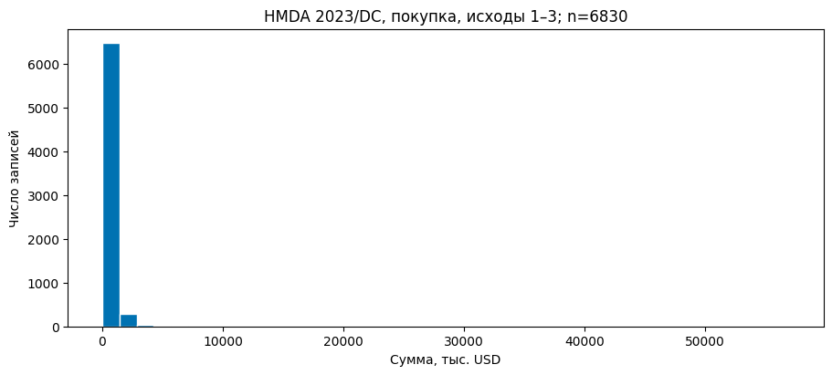
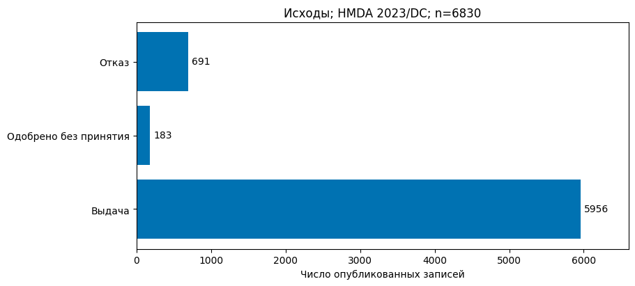
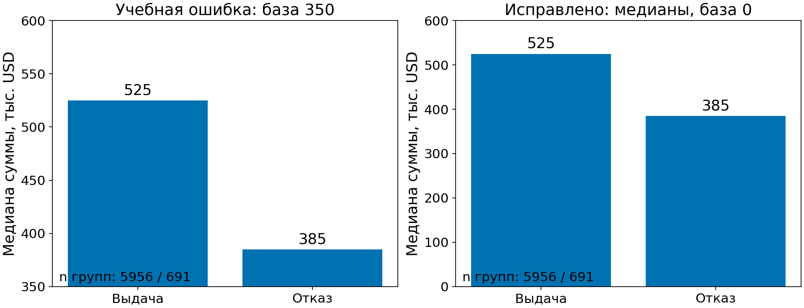
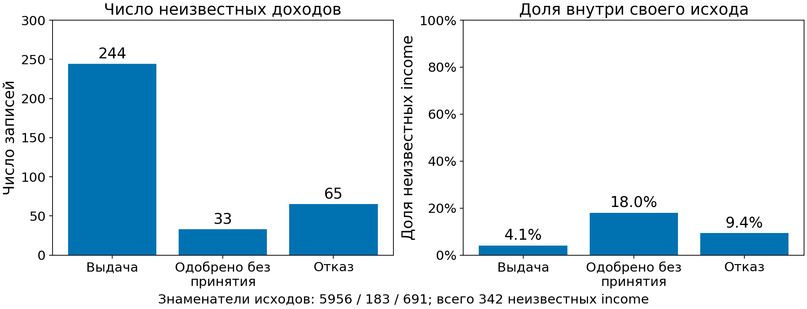
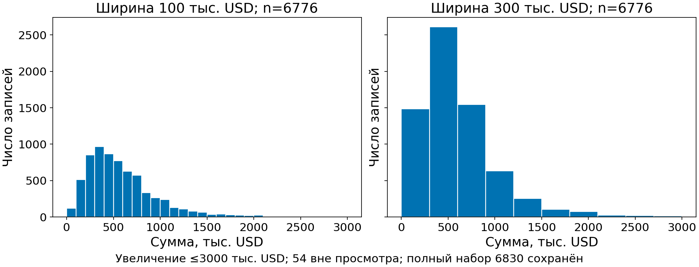
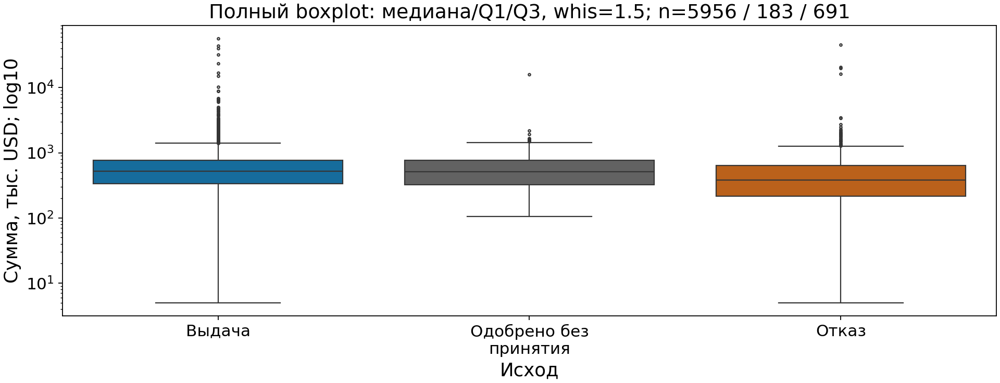
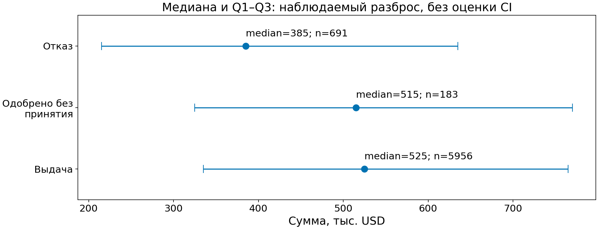
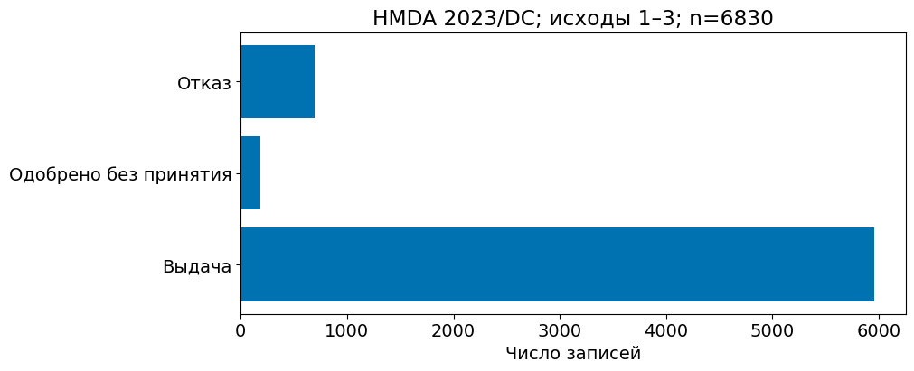

# Лекция 6 Графики и устойчивость аналитического вывода

2026-11-28. 90 минут.

Сначала изучите эту тему на лекции. На практике в этот день обсуждается предыдущая тема.

## 1 Как шкала меняет впечатление

Посмотрим на две медианы суммы: 525 тысяч долларов у выдач и 385 тысяч у отказов. Если столбцы начинаются с нуля, их длины относятся примерно как 1,36. Если обрезать ось снизу на уровне 350, видимые части будут 175 и 35 — отношение станет пять. Сами числа при этом не изменились.

Сегодня научимся строить график так, чтобы он передавал выбранный расчёт. Разберём, когда нужны столбцы, точки, гистограмма и scatter, как подписывать единицы и знаменатели, сохранять сопоставимые шкалы и экспортировать результат. Данные знакомые: те же 6830 ипотечных записей. Сначала читаем таблицу и вопрос, потом выбираем рисунок. Работа с оформлением здесь начинается с проверки смысла числа.

## 2 Выбираем график под вопрос

Если хотим сравнить количество исходов, у нас есть отдельные категории — выдача, одобрение без принятия и отказ. Для них подойдут столбцы. Если интересует распределение сумм, нужны числовые интервалы гистограммы или накопленная доля ECDF. Для связи двух количественных полей используем scatter.

Выбор формы начинается с вопроса и смысла одной строки. Сравнение медиан по организациям и распределение индивидуальных сумм требуют разных изображений. Перед построением назовите, что означает каждый будущий столбец или точка. Для длинных названий категорий часто удобны горизонтальные столбцы, для большого числа групп — точки. Таблицу тоже можно оставить, если читателю нужны точные значения нескольких показателей. График нужен там, где положение и форма помогают увидеть сравнение.

|Вопрос|Поля|Форма|
|---|---|---|
|Сколько каждого исхода?|Категория + число|Столбцы|
|Как распределена сумма?|Количественное поле|Histogram / ECDF|
|Различаются группы?|Категория + сумма|Boxplot / точки|
|Как связаны два поля?|Доход + сумма|Scatter|

## 3 Подписываем то, что посчитали

Возьмём loan_amount и переведём в тысячи долларов. Ось с надписью «Сумма» не объяснит, чем отличаются 500 и 500000: нужны единицы. В заголовке или подписи укажем, что анализируется HMDA за 2023 год, District of Columbia, и какие исходы вошли.

У графика распределения n — число сумм. У графика долей потребуется ещё знаменатель: внутри исхода, внутри организации или во всём наборе. Если показываем увеличенный участок, подпишем его границу и количество значений вне просмотра. Найдите одну строку исходной таблицы и объясните, куда попадёт её значение на рисунке. Такой разбор соединяет подписи с расчётом. Оформление готово, когда незнакомый с кодом читатель может правильно прочитать число.

## 4 Столбцы для частот категорий

Посчитаем записи каждого исхода и расположим результаты в порядке кодов 1, 2, 3. Только после этого передадим подписи категорий и количества в barh. Каждый горизонтальный столбец показывает число записей соответствующей категории.

Метод возвращает контейнер столбцов; bar_label добавит к ним значения. Ось количества начинается с нуля, потому что мы сравниваем длины. Сумма частот должна совпасть с 6830. Если меняем порядок категорий, одновременно меняем подписи и значения, иначе столбец получит чужое имя. Гистограмма устроена иначе: она считает значения внутри числовых интервалов. Здесь категории уже определены смыслом исходов. Сравните готовый рисунок с таблицей частот: сначала одно точное число, затем общее впечатление от длин.

## 5 Исправляем обрезанную ось

Вернёмся к двум медианам 525 и 385. В учебной ошибке ось начинается с 350. Разница видимых длин кажется гораздо больше отношения самих значений. Исправим предел через ylim=(0, ...), сохранив ту же таблицу и те же числа.

Подписи точных значений полезны, но не исправляют неверное впечатление от длины. Прочитаем оба отношения в коде: 525/385 и (525−350)/(385−350). После исправления сформулируем вывод про наблюдаемую разницу медиан. Если хотим показать небольшие различия на узком диапазоне, можно выбрать точки на общей оси: там сравнение основано на положении, а не длине от обрезанной базы. Этот вариант рассмотрим далее. Выбор формы должен соответствовать способу, которым читатель сравнивает значения.

## 6 Проценту нужен знаменатель

Построим долю пропусков дохода по исходам. Числитель — неизвестные income, знаменатель — все строки того же исхода. Для отказов это 65/691. Для выдач и одобрений без принятия берём их собственные количества.

В расчёте храним доли от нуля до единицы, а PercentFormatter(xmax=1) отображает их как проценты. Если передать уже умноженные на сто значения с тем же xmax, подписи будут ошибочными. Прочитаем одно значение по таблице и рисунку. В подписи укажем исход и n. Разная доля пропусков сообщает о составе наблюдаемых групп; она не объясняет причину отсутствия дохода. Перед передачей рисунка проверим, что процентная шкала соответствует способу хранения значений.

## 7 Ширина интервалов гистограммы

Возьмём суммы не выше трёх миллионов долларов и переведём в тысячи. Внутри просмотра 6776 записей, вне — 54. Для одной панели зададим интервалы шириной 100 тысяч, для другой — 300 тысяч. Пределы осей сохраним одинаковыми.

Более широкие интервалы объединяют соседние значения и сглаживают небольшие особенности. Узкие дают больше деталей, но могут подчёркивать случайные колебания. np.histogram вернёт количества и границы, а ax.hist построит соответствующие столбцы. Сумма количеств внутри панели должна дать 6776. Последний интервал включает правую границу; остальные обычно устроены как «слева включено, справа исключено». Назовите выбранное правило в подписи. Пик, исчезающий после небольшой смены ширины, требует осторожной интерпретации.

## 8 Boxplot по группам

Две группы с разными медианами могут сильно перекрываться по индивидуальным значениям. Boxplot помогает увидеть это: центральная линия — медиана, коробка — от Q1 до Q3, усы и отдельные точки зависят от заданного правила. Укажем whis=1.5 и сверим с квартилями pandas.

Стандартные усы не являются доверительным интервалом среднего и не обязаны охватывать все наблюдения. Размеры групп подпишем отдельно: ширина обычной коробки сама по себе не сообщает n. На широком диапазоне положительных сумм можно выбрать логарифмическую ось, но нужно назвать её явно. Прочитайте одну коробку: середина, центральный разброс, точки за усами. Затем сравните группы, сохраняя одинаковую шкалу и исходный набор.

## 9 У любой полосы есть определение

На рисунке рядом с точкой часто рисуют отрезок. По одному виду нельзя понять его смысл: это может быть диапазон, IQR, стандартное отклонение или доверительный интервал оценки. Каждый вариант отвечает на свой вопрос.

Покажем медиану и квартильный отрезок от Q1 до Q3. Он описывает разброс индивидуальных значений центральной части списка. Для этого не требуется считать повторные выборки. Подпишем, что точка — медиана, левый конец — Q1, правый — Q3. Не будем называть такую полосу погрешностью медианы. В следующей части этой лекции рассмотрим повторные выборки и интерпретацию интервала оценки. Сейчас достаточно проверить концы отрезка по таблице и точно назвать, что нарисовано.

## 10 История из нескольких графиков

Для записки выберем три–пять графиков, связанных одним вопросом. Например, сначала покажем распределение суммы, затем медианы по исходам, после этого — связь с доходом. Рядом с каждым рисунком запишем одно наблюдение, которое читатель может проверить по его осям и числам.

Переход между рисунками должен объяснять, зачем нужен следующий: после общей формы хочется понять, одинаковы ли группы; после групп — посмотреть дополнительный признак состава. Повторение одного и того же сравнения в разных видах не добавляет доказательств. В конце укажем ограничение и следующий шаг анализа. Если изображение красиво, но не отвечает на вопрос записки, его можно убрать. На практике вы сами выберете последовательность и обоснуете форму каждого рисунка.

## 11 Сохраняем и проверяем файл

fig.savefig сохраняет всю фигуру. figsize задаёт физический размер, dpi — плотность точек для растрового файла. При одинаковом размере в дюймах больший dpi даёт больше пикселей PNG, но не меняет данные и выбранные шкалы.

SVG хранит элементы векторно и удобно масштабируется. Для редактируемого текста Matplotlib можно задать svg.fonttype="none", при этом на компьютере получателя нужен подходящий шрифт. Сохраним оба варианта и откроем их отдельно: читаются ли оси и легенда, помещаются ли подписи, совпадают ли числа? Экспорт из ноутбука и обычный просмотр файла могут выглядеть по-разному. Рядом с изображениями сохраним код и таблицы расчётов. Получатель должен иметь возможность получить те же графики из исходных данных.

## 12 Одно число и его изменчивость

При повторном случайном отборе доля отказов может меняться от опыта к опыту. Сегодня разберём, как описывать эту изменчивость. Сначала различим параметр и статистику. Средняя сумма полного сохранённого снимка — фиксированное число для этого конечного набора. Средняя сумма случайно выбранных строк — статистика; она зависит от выборки.

В учебном опыте полный снимок доступен, поэтому можем видеть оба числа и проверять метод. В реальном исследовании интересующая совокупность часто полностью неизвестна. Тогда одна выборка даёт оценку, а неопределённость приходится оценивать при явных предположениях о сборе данных. Наши расчёты не превращают HMDA в случайную выборку всего рынка.

## 13 Почему нужна проверка предположений

Формула s/√n предполагает подходящую модель наблюдений. Если строки связаны общим источником, повторяют одного человека или зависят от времени, номинальное число строк может переоценивать количество независимой информации.

В нашем наборе есть много записей одной организации. Это повод обсудить зависимость и уровень выбора. Отдельно стоит проблема охвата: даже безошибочная формула для случайного выбора из снимка не описывает весь ипотечный рынок. До интервала нужно определить параметр, единицу наблюдения и механизм выборки. Если эти условия не обоснованы, вычисление можно показать как учебную модель с прямо названными предположениями. Численный интервал без этих сведений не сообщает читателю, к какому повторяемому опыту он относится.

## 14 Bootstrap: выборки из наблюдаемой выборки

Часто повторно собрать реальные данные нельзя. Bootstrap предлагает приближение: многократно выбирать с возвращением из уже наблюдаемой выборки. В каждом повторе сохраняем её размер и вычисляем ту же статистику.

Возьмём наш sample из двухсот сумм. Создадим две тысячи bootstrap-выборок по двести значений и посчитаем средние. Каждый повтор может содержать повторные значения и не включать часть исходных. Мы не генерируем новые независимые сведения о рынке: изучаем изменчивость оценки, используя эмпирическое распределение выборки как приближение. В показанном опыте считаем значения результатами независимых выборов по одному правилу; повторяем выбор на том же уровне строки. Сначала прочитаем размеры массивов, затем сопоставим одну повторную среднюю с исходной.

## 15 Процентильный интервал

Отсортируем bootstrap-средние и найдём значения на уровнях 0,025 и 0,975. Между ними находится центральная часть повторных оценок. Это процентильный bootstrap-интервал. На занятии используем его как понятный первый метод; для сложных распределений и малых выборок его свойства могут быть неудовлетворительными.

Обе границы измеряются в долларах, как среднее. Укажем исходный n, число bootstrap-повторов, seed и процедуру выбора. В учебном опыте можем отдельно посмотреть, попал ли известный параметр снимка внутрь. Один такой успех или промах ещё не оценивает надёжность метода. Для этого требуется повторять весь процесс: заново получать исходную выборку и строить по ней интервал.

## 16 Как читать доверительный уровень

Доверительный уровень относится к методу построения. Если многократно получать данные по заданной модели и каждый раз строить интервал, доля интервалов, покрывающих фиксированный параметр, должна быть близка к заявленному уровню при выполнении условий метода.

После наблюдения данных границы конкретного интервала уже зафиксированы. В частотной интерпретации мы не говорим, что фиксированный параметр случайно перемещается внутри него с вероятностью 95%. Более полезная формулировка для отчёта: оценка, интервал, использованный метод и его предположения. Не обещаем точное покрытие для любого набора: приближённые методы, небольшое n, тяжёлый хвост и зависимость могут его нарушать. Следующий опыт позволит увидеть эту разницу практически.

## 17 Выбираем на уровне независимых единиц

Для обсуждения уровня выборки получим одну среднюю сумму на каждую организацию. Теперь одна строка — организация, а среднее этих строк придаёт всем организациям одинаковый вес. Это уже другой параметр, чем средняя сумма одной ипотечной записи.

Можно выбирать с возвращением такие организационные средние и изучать изменчивость показателя с равными весами организаций. Если же хотим оценить среднюю по записям при кластерной выборке организаций, нужно сохранять все строки выбранных кластеров и отдельно определить веса. Эти задачи нельзя подменять друг другом. На этом примере главное — каждый раз называть, что выбирается и какой средний результат требуется. Код покажет новый уровень строки, а подпись зафиксирует смену вопроса.

## 18 Чувствительность результата

Изменение seed даёт другое конечное приближение bootstrap-распределения. При большем числе повторений границы обычно меньше колеблются от вычислительной случайности. Но это не исправляет отсутствие важных наблюдений в исходной выборке.

Отдельно меняется статистическая задача: среднее и медиана имеют разную чувствительность к крупным значениям. Если сравниваем их интервалы, подписываем именно соответствующие оценки; нельзя назвать один более точным только потому, что он уже. До выбора метода полезно посмотреть распределение, пропуски и размер выборки. Сохраним таблицу с оценкой, границами, единицей, n, числом повторов и допущением о независимости. На практике будем проверять не только запуск функции, но и соответствие этих подписей выполненной процедуре.

## 19 Наблюдательное сравнение и причинное объяснение

Группы выдач и отказов в HMDA возникли в процессе рассмотрения записей. Разница между ними может быть связана с суммой кредита, доходом, составом заявок или другими факторами. Поэтому вместе с различием покажите размеры групп, доступные признаки состава и ограничения отбора.

Пересчёт в более однородных группах помогает проверить устойчивость наблюдения. Для причинного вывода понадобятся обоснованный дизайн и дополнительные предположения. В описательном проекте сформулируйте наблюдаемый результат и назовите альтернативное объяснение.

Сквозные данные HMDA и словарь полей находятся в [карточке данных](../../01-introduction/data/card.md).
